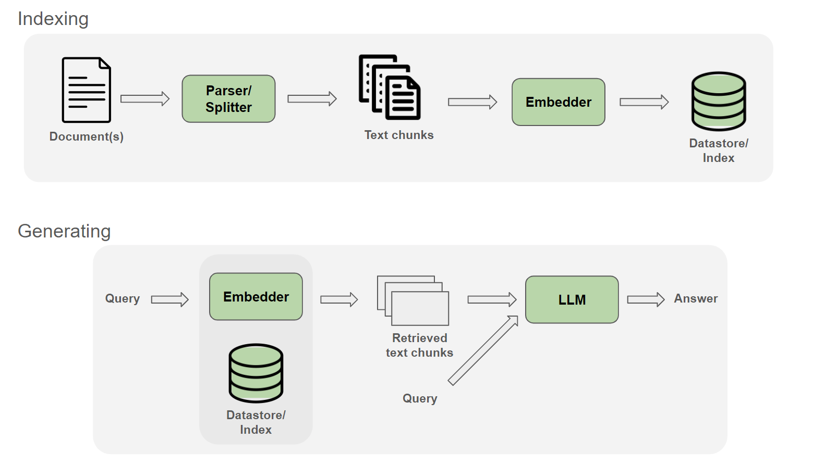

# RigAiGame

This is a project i made for learning how a RAG pipeline is made. It's premise is simple, I wanted an easier way to
search issues and fixes i dealt with in the past on my gaming PC. I already had lots of text and markdown (.md) files
around in a folder that i added to over the years. I just needed to search them more efficiently.

I tried to find a name that would reflect the purpose and be an acronym for RAG.

## Architecture

It follows the industry standard RAG pipeline architecture. We use a completely local setup on my RTX 5080 GPU, in order
to demonstrtate the principles of a RAG pipeline, and avoid any cloud costs.

Tech Stack:

* Ollama - for managing the local AI models (qwen3.5 and qwen-embedding)
* OllamaSharp - the best C# client for Ollama
* .NET Semantic Kernel ecosystem - provides abstractions for vector Databases & semantic text chunking
* Spectre.Console/TUI - A console-based frontend for the user prompts

## Conversational RAG

I wanted to go a step further beyond the tutorials and make the RAG conversational. This means the user can ask
follow-up questions and the system will remember the context of the previous questions and answers.

To achieve this, we use a custom system prompt to instruct the model to base the answers on the documentation context
first, but to also be flexible and use it's training data.

## File ingestion & indexing

At app startup, you are asked if you want to regenerate embeddings. This can be made automaic easily by comparing the
last modified date of the files with the one stored with the record of the embeddings. If the files have a newer
timestamp, rerun the generation just for those modified files.
